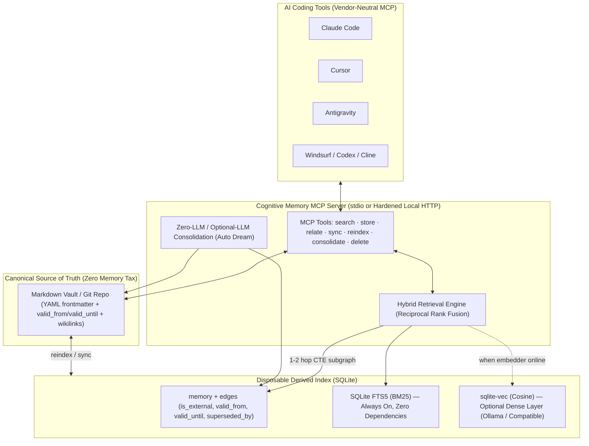

# Cognitive Memory v2.0 Architecture

> **Status:** Active implementation target (post-v1.6.0)  
> **Design Goals:** Cross-tool portability · Zero mandatory Ollama · Markdown-first truth · Measurable retrieval via `evals/`

---

## 1. High-Level Data Flow

---

## 2. Core Architectural Pillars

### Pillar 1: Inverted Storage Pyramid (Markdown-First, SQLite as Rebuildable Index)

- **Canonical Storage:** Plain Markdown notes with structured YAML frontmatter (`id`, `profile`, `scope`, `importance`, `valid_from`, `valid_until`, `superseded_by`, `ref`). Directly readable by humans, diffable in Git, searchable with `grep`, and editable in Obsidian.
- **Zero-Copy Grounding:** Memories may attach a validated `ref` pointer (`vault_path`, `wikilink`, `source_hash`, `section`) and external `grounded_in` / `references` edges (`obsidian://`, `vault://`) so agents can jump straight back to raw source files instead of relying solely on lossy summaries.
- **Disposable Index:** `cognitive-memory reindex` reconstructs `memory`, `fts_memory`, `edges`, and (if an embedder is enabled) `vec_memory` cleanly from Markdown files without data loss.

### Pillar 2: Zero-Ollama Hybrid Retrieval (`FTS5` BM25 + Optional Dense RRF)

- **Always-On Lexical Engine:** Every active memory (`is_active = 1` and not temporally superseded) is indexed in SQLite `FTS5` across both `main` (project-local) and `global` (`~/.cognitive-memory`) schemas.
- **Graceful Degradation:** If Ollama is stopped, unreachable, or disabled (`EMBEDDING_PROVIDER=none`), `memory_store` and `memory_search` **never fail** — they operate instantaneously in pure BM25/FTS5 mode.
- **Hybrid RRF Fusion:** When embeddings are available (Ollama or pluggable provider), `memory_search` runs both `FTS5` BM25 and single-pass CTE `sqlite-vec` cosine search and merges candidates via **Reciprocal Rank Fusion**:
  $$\text{RRF}(d) = \sum_{r \in \{\text{bm25}, \text{vec}\}} \frac{w_r}{k + \text{rank}_r(d)}$$
  capturing exact identifiers/error codes (BM25) _and_ conceptual paraphrases / cross-lingual queries (dense vectors).

### Pillar 3: Temporal Supersession & Bounded Graph (1–2 Hops)

- **Solving Contradictions:** Updating or superseding a fact sets `valid_until = CURRENT_TIMESTAMP` and `superseded_by = <new_id>` on the old record (creating a `supersedes` edge) instead of leaving conflicting active facts or permanently destroying history.
- **Bounded Subgraph Expansion:** Optional `includeGraph: true` (depth capped at `1` or `2` via SQLite recursive CTE) returns directly connected memories and `grounded_in` external pointers in a single tool call, avoiding both multi-turn round-trips and 3-hop hairball noise.

### Pillar 4: Memory Profiles & Federated Scopes

- **Scopes (`local` | `global` | `all`):** Project-specific knowledge stays in the local DB/vault; cross-project user preferences and tool conventions live in `~/.cognitive-memory/`.
- **Profiles (`user` | `working` | `agent_core`):** Separates stable user preferences, ephemeral working investigations, and invariant architectural rules.

### Pillar 5: Security-by-Default Transport

- **Default (`stdio`):** Pure JSON-RPC on stdout (all logs strictly routed to stderr).
- **HTTP/SSE Local Daemon:** Binds to `127.0.0.1` by default, enforces localhost-only CORS, uses relative message endpoints, and refuses non-loopback binding unless `MCP_AUTH_TOKEN` is configured (verified with timing-safe comparison).

### Pillar 6: Continuous Harness Engineering

- **Single local/CI verification command:** `pnpm verify` (Biome + root `tsc` + build + unit/integration tests + offline eval gate + UI build/tests).
- **Eval Tracks (`evals/`):** Benchmarks `bm25` vs. `dense` vs. `hybrid-rrf`, temporal contradiction resolution, distractor noise stress tests, and Markdown round-trip invariants.
- **3D Web UI (`ui/`):** Frozen as an optional read-only visualization companion; core engineering investment stays on retrieval quality, storage integrity, and cross-tool ergonomics.
